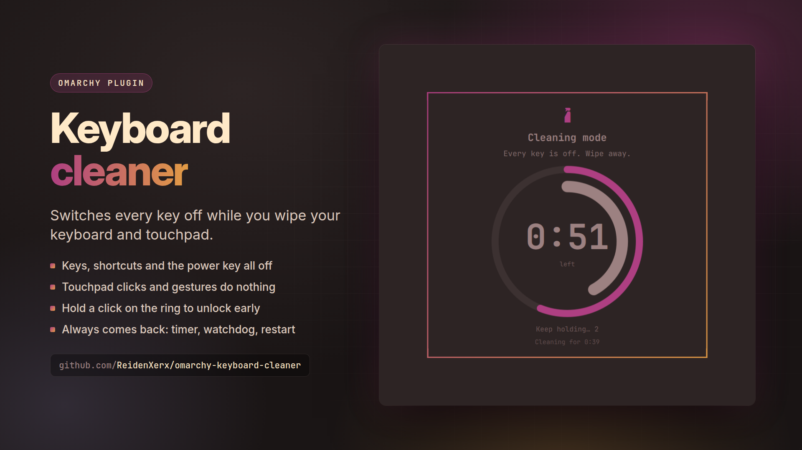

# Keyboard cleaner



An [Omarchy](https://omarchy.org) plugin that **switches every key off while you wipe your
keyboard and touchpad**. A full-screen card in your theme counts down; hold a click on the
ring for three seconds to unlock early, or let the timer end it.

Like KeyboardCleanTool on macOS, but built for Hyprland: the keys are switched off in the
compositor itself, so not even a keybinding or the power key reacts.

 

## Install

```bash
omarchy plugin add https://github.com/ReidenXerx/omarchy-keyboard-cleaner.git --enable
```

Optionally add its entries to the Omarchy menu, so it is searchable (and so the emergency
unlock is one search away):

```bash
~/.config/omarchy/plugins/reidenxerx.keyboard-cleaner/bin/keyboard-cleaner-menu-install
```

Requires Hyprland 0.56 or newer (Lua config) and `python3`, both on a stock Omarchy install.
`systemd-inhibit` is used when present.

## Use

| action | result |
|---|---|
| **click** the spray bottle in the bar | cleaning mode for the configured time (90 s by default) |
| Omarchy menu → Setup → Keyboard cleaner | clean for 1, 2 or 5 minutes |
| **hold a click on the ring** for 3 seconds | unlock early |
| let the countdown reach 0:00 | unlocks by itself |

While it is on:

- **Every key is off** — letters, Super shortcuts, media, brightness and power keys, and any
  keyboard you plug in mid-clean.
- **The touchpad and mouse do nothing** — clicks, scrolls and drags land on the card, and
  Hyprland's own touchpad gestures are paused.
- **The display stays awake**, and the card shows on every monitor with the time left and how
  long you have been cleaning.

The hold has to stay still: moving the pointer cancels it, so a cloth sweeping across the
touchpad cannot unlock by accident. The lock time is the widget's `seconds` setting (15–600).

## Getting the keyboard back

A plugin that switches your keyboard off must never leave it off, so the keys come back on
four independent paths:

1. **The guard** — the helper that holds the lock switches everything back on when you hold
   the ring, when the timer ends, when it receives a signal, and the moment its stdin closes
   (whatever started it is gone).
2. **The shell** — the guard is set to be signalled when the shell that started it exits, so a
   shell crash or restart is path 1.
3. **The watchdog** — before anything is switched off, a separate process is started in its own
   session. A few seconds after the deadline it switches everything back on, even if the guard
   was killed outright.
4. **Every shell start** — the overlay restores any lock left behind whenever it loads.

The names of the devices it switches off are written to
`$XDG_RUNTIME_DIR/reidenxerx.keyboard-cleaner/lock.json` *before* the first one goes off, so every
path knows exactly what to switch on. If that record is ever unreadable, restore switches on
every keyboard there is instead — turning a keyboard on is never the dangerous direction. A
Hyprland config reload also switches devices back on.

Manual escape hatch, from any terminal or the Omarchy menu ("Switch the keyboard back on"):

```bash
/usr/bin/python3 ~/.config/omarchy/plugins/reidenxerx.keyboard-cleaner/bin/keyboard-cleaner restore
```

## How it works

- Every device `hyprctl devices` lists as a keyboard is switched off with
  `hyprctl eval 'hl.device({ name = "…", enabled = false })'` — the same mechanism Omarchy's own
  touchpad toggle uses. The lock re-asserts itself every two seconds, which also catches a config
  reload and newly plugged keyboards.
- The power, suspend and hibernate keys are also held with `systemd-inhibit --mode=block`, for
  systems where logind acts on them without Hyprland.
- Pointer devices stay on; the card is a full-screen layer surface on every output that swallows
  their input. Its focused surface holds a **shortcuts inhibitor**, which pauses Hyprland's
  keybinds and touchpad gestures, and an **idle inhibitor**, which keeps the display awake.

Notes:

- Keys your laptop's firmware handles on its own (some brightness or keyboard-backlight Fn keys)
  never reach Linux, so no software can stop them.
- Closing the lid still suspends: the lid switch is not a keyboard.

## Security

- **No shell.** The overlay only ever runs `/usr/bin/python3 bin/keyboard-cleaner …` and the bar
  button only `/usr/bin/omarchy-shell shell toggle …`, both as argument lists.
- **Trusted tools, bounded runs.** The helper runs only root-owned tools from `/usr/bin`
  (`hyprctl`, `systemd-inhibit`, `timeout`, `sleep`), never via `PATH`, each with a hard deadline,
  an output ceiling and a whole-process-group kill.
- **Device names are data.** Names come from hardware descriptors, so every one is written into
  the Lua call as a string literal whose every byte outside printable ASCII — and every quote and
  backslash — is a decimal escape; tests feed quote, bracket, newline and NUL names through it.
- **Bounded, validated state.** The lock record is capped at 64 KB, read only if it is a regular
  file you own reached without symlinks, checked field by field, and written through a random
  `O_EXCL` temporary file and an atomic rename.
- **Validated arguments.** `lock` accepts only 15–600 seconds; the watchdog's lock id and deadline
  are pattern-checked before use.

All of this is `bin/plugin_safety.py`, a shared library vendored unchanged into each of these
plugins.

```bash
python3 tests/helper_test.py        # lock, unlock, timer, signals, reloads, hotplug, watchdog, hostile names
python3 tests/menu_install_test.py
node tests/model-test.js
```

## Menu entries

A plugin cannot register Omarchy menu routes itself — Omarchy builds its menu from its own file
plus one user file. Opt in with:

```bash
bin/keyboard-cleaner-menu-install          # add them
bin/keyboard-cleaner-menu-install remove   # take them out
bin/keyboard-cleaner-menu-install print    # just show the snippet
```

It writes only between its own marker comments in
`~/.config/omarchy/extensions/omarchy-menu.jsonc`, leaves the rest of that file byte for byte, is
safe to re-run, and puts the previous content back (held in memory, never in a side file) rather
than leaving the file unparseable.

## Remove

```bash
bin/keyboard-cleaner-menu-install remove   # if you added the menu entries
omarchy plugin remove reidenxerx.keyboard-cleaner
```

Nothing else is left behind: the lock record lives in the runtime directory and only exists
while a lock does.

## License

MIT
